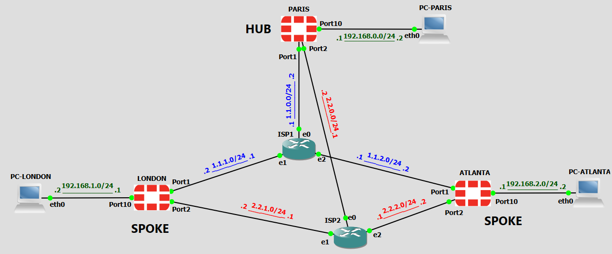
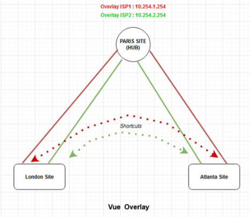

# Architecture

## Vue d'ensemble

Chaque site dispose de deux accès Internet ISP1 et ISP2 (underlay)
Deux overlays IPsec (un par ISP) relient chaque spoke au hub. Les adresses overlay (10.254.1.0/24 et 10.254.2.0/24) sont distribuées dynamiquement par le hub (`mode-cfg`).

| Site | Rôle | port1 (ISP1) | port2 (ISP2) | port10 (LAN) |
|---|---|---|---|---|
| FG-PARIS | Hub, datacenter | 1.1.0.2/24 | 2.2.0.2/24 | 192.168.0.1/24 |
| FG-LONDRES | Spoke | 1.1.1.2/24 | 2.2.1.2/24 | 192.168.1.1/24 |
| FG-ATLANTA | Spoke | 1.1.2.2/24 | 2.2.2.2/24 | 192.168.2.1/24 |

Les passerelles de chaque site sont les adresses `.1` des réseaux correspondants sur ISP1 et ISP2 (par exemple 1.1.1.1 et 2.2.1.1 pour London).

## Overlays IPsec

| Overlay | Réseau | IP PARIS | IP LONDRES | IP ATLANTA |
|---|---|---|---|---|
| ISP1 (VPN-ISP1) | 10.254.1.0/24 | 10.254.1.254 | 10.254.1.1 | 10.254.1.2 |
| ISP2 (VPN-ISP2) | 10.254.2.0/24 | 10.254.2.254 | 10.254.2.1 | 10.254.2.2 |

- IKEv2, un tunnel par ISP et par spoke : `VPN-ISP1` (via port1, `network-id 1`) et `VPN-ISP2` (via port2, `network-id 2`).
- Sur le hub, les phase 1 sont de type `dynamic` : chaque spoke qui se connecte crée sa propre instance (`VPN-ISP1_0`, `VPN-ISP1_1`, etc.).
- Le hub distribue les adresses overlay par `mode-cfg` : pool 10.254.1.1 à 10.254.1.250 pour l'overlay 1, 10.254.2.1 à 10.254.2.250 pour l'overlay 2. L'adresse du hub est 10.254.1.254 sur l'overlay 1 et 10.254.2.254 sur l'overlay 2.
- L'attribution suit l'ordre de connexion des spokes : les adresses overlay d'un site peuvent donc changer après une reconnexion.
- Le hub a `auto-discovery-sender` et les spokes `auto-discovery-receiver`, ce qui permet les shortcuts ADVPN.
- Propositions de chiffrement `des-md5` / `des-sha1` : acceptables uniquement en lab.

## Routage BGP

- iBGP, AS 65000, avec FG-PARIS en route reflector.
- Le hub utilise un `neighbor-range` par overlay (10.254.1.0/24 et 10.254.2.0/24) : tout spoke dont l'adresse overlay est dans la plage est accepté sans configuration supplémentaire. Chaque spoke n'a que deux sessions, une par overlay.
- Le hub a `route-reflector-client` et `additional-path send` ; les spokes ont `additional-path receive`, ce qui donne deux chemins par LAN distant (un par overlay).
- Timers : keepalive 3 s, hold time 9 s.
- Chaque spoke annonce son LAN. Le hub annonce 192.168.0.0/24 avec `next-hop-self`, qui ne s'applique pas aux routes réfléchies : le LAN d'un spoke garde donc comme next-hop l'adresse overlay du spoke d'origine. C'est ce qui permet les shortcuts.

## Adhérence du trafic hub vers spokes

Les sondes SLA d'un spoke ne contrôlent que le trafic sortant du spoke. Pour que le retour suive le même lien, l'état du SLA est transmis au hub par BGP.

1. Sur chaque spoke, une route-map de sortie ajoute une community à l'annonce : **65000:1** (overlay 1) ou **65000:2** (overlay 2) quand le SLA `hub_sla` est respecté, **65000:11** quand il ne l'est plus.
2. Sur le hub, des `community-list` reconnaissent ces valeurs et la route-map `bgp_rt` les convertit en route-tag (1, 2 ou 11).
3. Trois règles SD-WAN du hub s'appuient sur ce tag :

| Règle | Route-tag | Envoie le trafic vers |
|---|---|---|
| `vers_branches_isp` | 1 | VPN-ISP1 |
| `vers_branches_isp2` | 2 | VPN-ISP2 |
| `vers-branches-all` | 11 | VPN-ISP1, sinon VPN-ISP2 |

Quand l'overlay 1 d'un spoke est dégradé, sa route via l'overlay 1 porte le tag 11 et seule la règle du tag 2 correspond encore : le retour passe par l'overlay 2.

## SD-WAN des spokes

Membres de la zone `virtual-wan-link` : VPN-ISP1, VPN-ISP2 (coût 50), port1 et port2 (sorties Internet directes).

**Sondes (health-checks)**

| Sonde | Cible | Seuils |
|---|---|---|
| `srv1` | 192.168.0.2 | latence 50 ms, gigue 10 ms |
| `hub_sla` | 192.168.0.1 | latence 100 ms, gigue 30 ms, perte 3 % |
| `Default_Google Search` | 8.8.8.8 (ping) | latence 50 ms, gigue 50 ms, perte 5 % |

**Règles**

| Règle | Trafic | Comportement |
|---|---|---|
| `lan-DC` | vers `srv1` | `mode priority`, sonde `srv1`, membres 1 et 2 |
| `gmail` | service Google-Gmail | membre 3 (port1) |
| `branch-sites` | vers 192.168.0.0/16 | mode SLA, membres 1 et 2 |
| `internet` | tout le reste | `load-balance`, membres 4, 3, 2, 1 (round-robin observé) |

## Routage statique

- **Spokes** : routes vers 1.1.0.0/16 et 2.2.0.0/16 via les passerelles de port1 et port2, pour que le trafic IKE vers le hub sorte par la bonne interface physique. La route par défaut pointe vers la zone SD-WAN (distance 1).
- **Hub** : deux routes par défaut en ECMP (distance 10) via port1 et port2, plus les routes vers 1.1.0.0/16 et 2.2.0.0/16.

## Politiques de pare-feu

- **Spokes** : zone SD-WAN vers LAN ; LAN vers SD-WAN pour 192.168.0.0/16, **sans NAT** (les sites se voient avec leurs vraies adresses) ; LAN vers SD-WAN pour le reste, **avec NAT** (sortie Internet).
- **Hub** : LAN vers SD-WAN ; SD-WAN vers LAN sans NAT ; agence vers agence (transit par le hub avant la création du shortcut) ; LAN et agences vers Internet (port1 et port2) avec NAT.

## Shortcuts ADVPN

Quand le hub voit passer du trafic d'un spoke vers un autre, il leur permet d'établir un tunnel direct. La route BGP ne change pas : seul le next-hop (l'adresse overlay du spoke distant) est résolu par le tunnel direct au lieu du tunnel vers le hub. Le shortcut est créé à la demande et supprimé après un temps d'inactivité.
