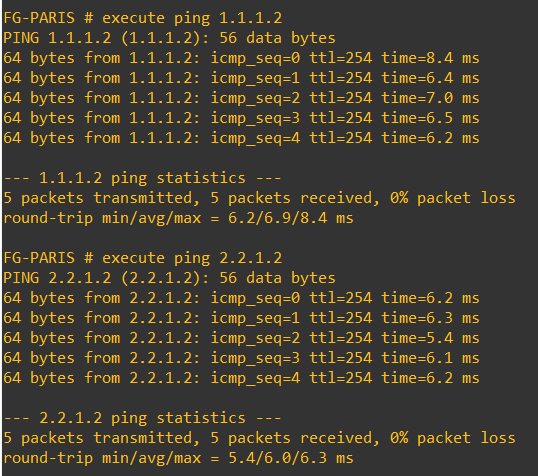
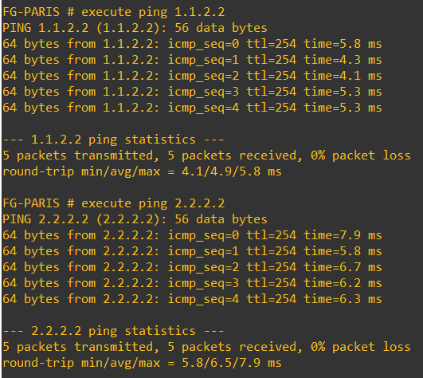
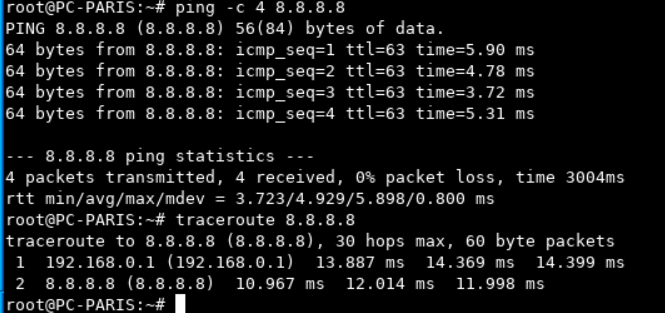
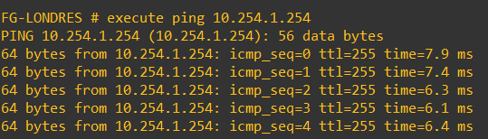
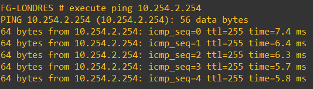
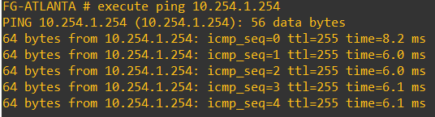
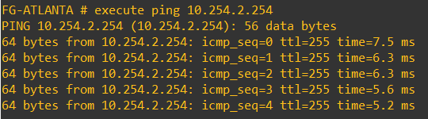

# Tests de connectivité de l'underlay depuis PARIS

### Vers LONDON

### Vers ATLANTA

### Vers Internet

# Tests de connectivité de l'overlay 

### Connectivité de LONDON Vers PARIS

### Connectivité de ATLANTA Vers PARIS

